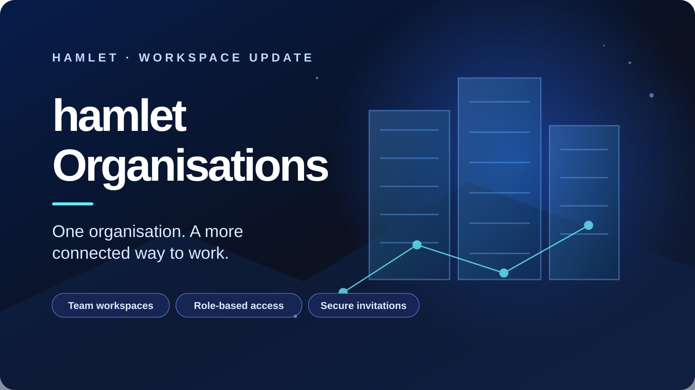

# Hamlet introduces Organisations, bringing a more connected way of working to property teams

**Press release · For immediate release**  
**Publication date:** 10 November 2026  
**Issued by:** Impact in Business Recruitment Group Limited  
**Category:** Product enhancement

*The new organisation workspace gives property firms and broker teams a structured way to establish an organisation, invite colleagues and manage membership through defined access roles — while keeping individual accounts and personal records distinct.*

**LONDON, United Kingdom — 10 November 2026** — Impact in Business Recruitment Group Limited today announces **hamlet Organisations**, a product enhancement that extends Hamlet beyond the individual professional account and introduces a dedicated organisational layer for property businesses, brokerages and professional teams.

Property work is collaborative by nature. Transactions involve colleagues with different responsibilities, levels of authority and information needs. Yet teams can find themselves coordinating activity across disconnected accounts and informal processes. Hamlet Organisations is designed to provide a more coherent foundation: an identifiable organisation, its members and a structured approach to access and administration within the Hamlet environment.

## Organisation creation and identity

Authenticated Hamlet members can create an organisation by supplying its name and a unique URL slug. The member who creates it becomes its initial owner. Hamlet validates and reserves organisation names and slugs through the organisation creation process, establishing a distinct identity for the organisation within the platform.

The slug currently serves as a reserved organisation identifier. A dedicated organisation subdomain or independently activated organisation web address is not implied by this release.

## Membership built for teams

Organisations can accommodate multiple members, and a Hamlet member can belong to more than one organisation. This supports professionals who work across a brokerage, group company, specialist practice or other organisational relationship without requiring their individual Hamlet account to be replaced.

Membership is structured around five defined roles:

- **Owner:** the initial organisation creator and primary organisation authority.
- **Administrator:** a role intended for organisation administration, including membership administration.
- **Manager:** a role for workspace coordination.
- **Member:** standard organisation membership.
- **Viewer:** read-only access.

These role distinctions provide an organisational access framework rather than treating every colleague as an unrestricted administrator. The precise actions available to each role remain governed by Hamlet's implemented permission controls.

## Colleague invitations and controlled acceptance

Organisation owners and authorised administrators can create invitations for colleagues using the colleague's email address and a selected organisation role. The invitation process uses a one-time token. To accept an invitation, the recipient must be signed in and use the same verified email address to which the invitation was issued.

This approach is intended to make membership deliberate and attributable: an invitation is created for a named email address, and acceptance is tied to the recipient's verified account rather than an open, unrestricted join link. Organisation managers can coordinate workspace activity, while membership administration remains with the roles authorised to perform it.

## Personal accounts remain distinct

A central design principle of Hamlet Organisations is the separation of organisation membership from personal ownership. Creating or joining an organisation does not automatically transfer an individual's privately owned deals or property records into an organisation workspace, nor does it make those records shared by default. This distinction helps preserve the boundary between a professional's personal account and their organisational relationships.

## A foundation for connected professional work

Hamlet Organisations is an important step in the platform's evolution: it introduces the identity, membership and access structure needed to support teams alongside individual brokers. It complements Hamlet's wider focus on connected property information, portfolio activity, collaboration and deal workflows. The enhancement establishes an organisational foundation on which further team-oriented capabilities can be developed in a controlled and coherent manner.

> “Hamlet has always been about reducing fragmentation and making professional property work more connected. Organisations is a significant step in that direction. It recognises that our users do not operate in isolation — they work within firms, teams and wider professional relationships. We are giving those relationships a proper place in Hamlet, with clear membership, defined roles and a deliberate separation between personal and organisational records. This is an important foundation for the next stage of the platform.”
>
> **Alfred Anate Bodurin Mayaki**  
> Founder and Managing Director, Impact in Business Recruitment Group Limited

Hamlet Organisations forms part of the continuing development of Hamlet by Impact in Business Recruitment Group Limited. Further information is available at [hamlet-ai.co.uk](https://hamlet-ai.co.uk) and on the [Hamlet Organisations page](https://hamlet-ai.co.uk/organisations.html).

---

**ENDS**

## About Hamlet

Hamlet is an integrated commercial and residential property workspace developed by Impact in Business Recruitment Group Limited. Designed for property brokers and professionals, Hamlet brings together property listings, portfolio management, broker collaboration and deal workflows in a connected digital environment. Its product vision is centred on reducing fragmentation across property transactions and supporting a more connected approach to commercial and residential property activity.

**Media contact:** Impact in Business Recruitment Group Limited  
**Website:** https://hamlet-ai.co.uk  
**Spokesperson:** Alfred Anate Bodurin Mayaki, Founder and Managing Director
