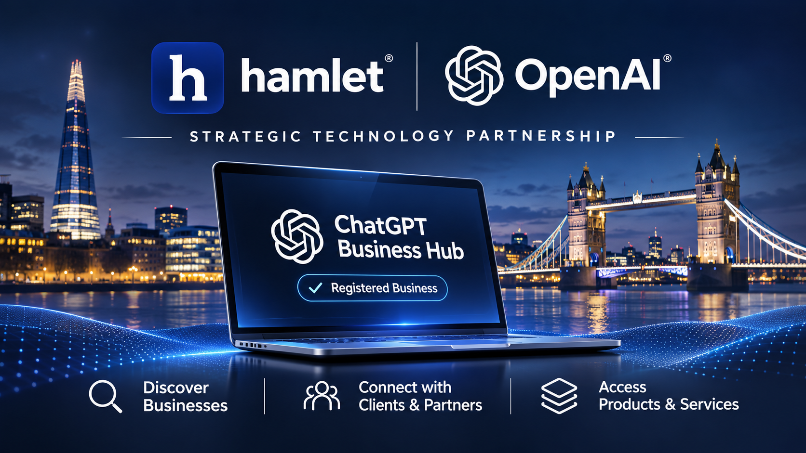

# PRESS RELEASE

**FOR IMMEDIATE RELEASE**

**Publication date:** 13 November 2026  
**Issued by:** Impact in Business Recruitment Group Limited  
**Brand:** Impact in Business Recruitment Group Limited · hamlet  
**Category:** Company announcement · AI and business discovery

# Impact in Business Recruitment Group joins OpenAI's ChatGPT Business Hub

**The London-focused company welcomes a new route for businesses to manage their presence and participate in AI-enabled business discovery, while continuing to expand the Hamlet proposition for organisations.**

*Hamlet's registration on ChatGPT Business Hub. The banner says “Strategic Technology Partnership”; IBR registration does not indicate a formal partnership or OpenAI endorsement.*

**LONDON, United Kingdom — 13 November 2026** — Impact in Business Recruitment Group Limited (IBR), the company behind the Hamlet technology platform, is delighted to announce that it has joined OpenAI's ChatGPT Business Hub as a registered business entity.

The development marks another step in IBR's commitment to digital innovation, artificial intelligence and the changing ways in which businesses and customers find one another. As people increasingly use AI assistants to research products, compare services and explore providers, accurate and useful business information is becoming an important part of how organisations present themselves online.

## A new environment for business discovery

OpenAI's Businesses in ChatGPT initiative and its Business Hub give eligible businesses a place to claim and manage their business presence in ChatGPT. Depending on eligibility and the features available to an account, businesses can manage profile information and access business-facing tools and insights.

For people using ChatGPT, the wider experience is an increasingly conversational way to explore businesses and their offerings: from finding a specialist supplier or professional service to researching products, identifying potential partners and considering options for personal or commercial needs.

For businesses, this creates an opportunity to make clear, relevant information about their organisation, products and services available within an emerging AI-powered discovery environment. A Business Hub registration does not guarantee that a business will appear in every relevant answer or receive preferential placement; discovery and recommendations remain dependent on the product experience and its systems.

## A message from the Managing Director

Alfred Anate Bodurin Mayaki, Founder and Managing Director of Impact in Business Recruitment Group Limited, said:

> “I am absolutely delighted that Impact in Business Recruitment Group has joined this growing community of businesses through OpenAI's ChatGPT Business Hub.
>
> “London has always been one of the world's most dynamic centres for entrepreneurship, professional services, investment and commercial innovation. I am particularly enthusiastic about being part of a growing community of London-focused businesses embracing new opportunities to connect with customers, partners and the wider business community.
>
> “I see this as more than registering another business profile. It represents a forward-looking commitment to the possibilities that artificial intelligence can unlock for businesses of every size. I am exceptionally optimistic about what lies ahead, and I look forward to seeing how this new generation of AI-enabled business discovery can create opportunities for greater visibility, collaboration and commercial growth.”

## Hamlet: expanding the connected business proposition

The announcement comes at an important point in the development of Hamlet, IBR's technology proposition.

Hamlet was established around a straightforward ambition: **less fragmentation, more connected deals**. Initially developed as a specialist digital environment for commercial property professionals, with an emphasis on sustainable property, energy efficiency and the changing requirements of the built environment, Hamlet has continued to expand beyond its original proposition.

The introduction of **Hamlet Organisations** represents a significant stage in that evolution. It extends the platform's focus beyond individual professional accounts, introducing dedicated organisational workspaces and a structured foundation for membership, roles and team collaboration.

IBR is now expanding Hamlet's proposition further, with an exciting collection of new capabilities intended specifically for Hamlet Organisations. This next phase is designed to give organisations more ways to coordinate their work, support commercial relationships and make use of intelligent digital workflows within a connected platform environment.

The roadmap reflects IBR's ambition to position Hamlet as more than a conventional CRM: a connected business environment bringing organisations, professionals, technology and commercial opportunities closer together.

As artificial intelligence, business discovery and digital infrastructure continue to evolve, Hamlet will remain focused on developing practical technology that helps organisations work more intelligently and collaboratively.

**The future of business is connected. Hamlet is building towards it.**

Further information is available at [hamlet-ai.co.uk](https://hamlet-ai.co.uk).

---

**-- ENDS --**

## About Impact in Business Recruitment Group Limited

Impact in Business Recruitment Group Limited is a London-focused business behind Hamlet, an evolving technology platform bringing together professional networks, commercial property, organisational workspaces and AI-enabled business functionality.

Through Hamlet, the Group is developing connected digital infrastructure designed to reduce fragmentation, facilitate commercial collaboration and support the changing requirements of modern businesses.

Website: [https://hamlet-ai.co.uk](https://hamlet-ai.co.uk)

---

## Editorial and publication notes

- **Media status:** For immediate release
- **Approved company attribution:** Impact in Business Recruitment Group Limited
- **Spokesperson:** Alfred Anate Bodurin Mayaki, Founder and Managing Director
- **Supporting reference:** [OpenAI — Businesses in ChatGPT](https://openai.com/index/businesses-in-chatgpt/)
- **Archive location:** `press/2026/November/`

*This announcement concerns IBR's registration with ChatGPT Business Hub. It does not imply an endorsement, partnership, certification or preferential placement by OpenAI. Business Hub features and eligibility are subject to OpenAI's terms and availability.*
