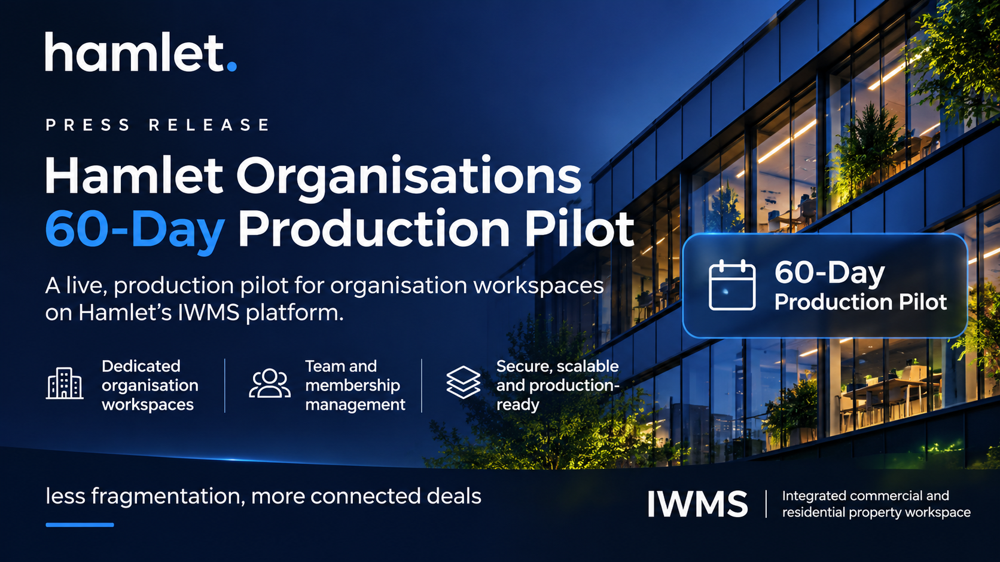

# Hamlet launches Organisations pilot with five UK agencies

**Press release · For immediate release**  
**Publication date:** 28 November 2026  
**Issued by:** Impact in Business Recruitment Group Limited  
**Brand:** hamlet Organisations  
**Category:** Product pilot

*Five UK agencies will test Hamlet Organisations, provide structured feedback and work with Hamlet to coordinate feature enhancements.*

**LONDON, United Kingdom — 28 November 2026** — Impact in Business Recruitment Group Limited today announces the launch of a product pilot for **hamlet Organisations**, bringing together a cohort of five UK agencies to test the organisational workspace and help shape its development.

The pilot follows the introduction of Hamlet Organisations, which gives property businesses and professional teams a dedicated organisational layer within Hamlet. It supports organisation identity, team membership and role-based access while keeping individual accounts and personal records distinct.

During the pilot, the participating agencies will use Hamlet Organisations and provide structured feedback on their experience. Hamlet will work with the agencies to review that feedback, identify priorities and coordinate feature enhancements informed by what participants learn through testing.

The pilot creates a focused way for Hamlet and participating agencies to collaborate on product improvements. Feedback from the cohort will help guide the next stage of development as Hamlet continues to build tools for connected property work.

Further information about Hamlet is available at [hamlet-ai.co.uk](https://hamlet-ai.co.uk). Read more about [Hamlet Organisations](https://hamlet-ai.co.uk/organisation.html).

---

**ENDS**

## About Hamlet

Hamlet is an integrated commercial and residential property workspace developed by Impact in Business Recruitment Group Limited. Designed for property brokers and professionals, Hamlet brings together property listings, portfolio management, broker collaboration and deal workflows in a connected digital environment. Its product vision is centred on reducing fragmentation across property transactions and supporting a more connected approach to commercial and residential property activity.

**Media contact:** Impact in Business Recruitment Group Limited  
**Website:** https://hamlet-ai.co.uk
